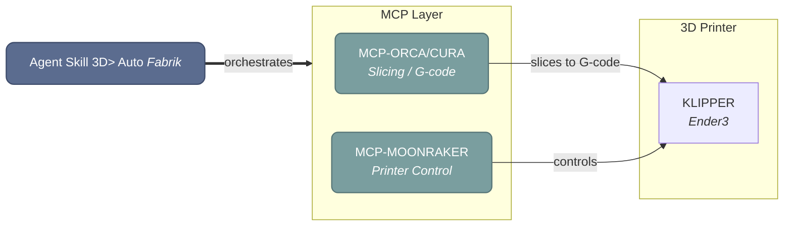
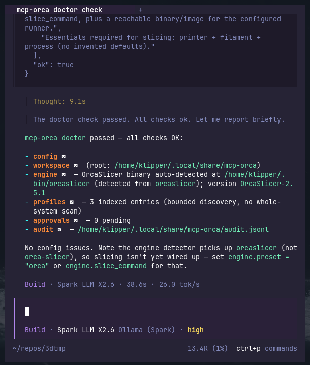
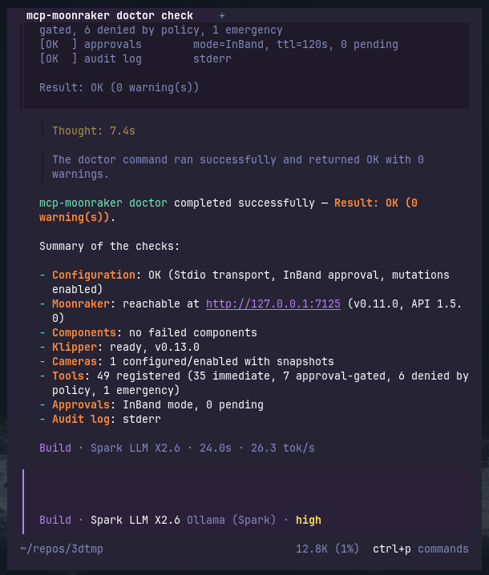
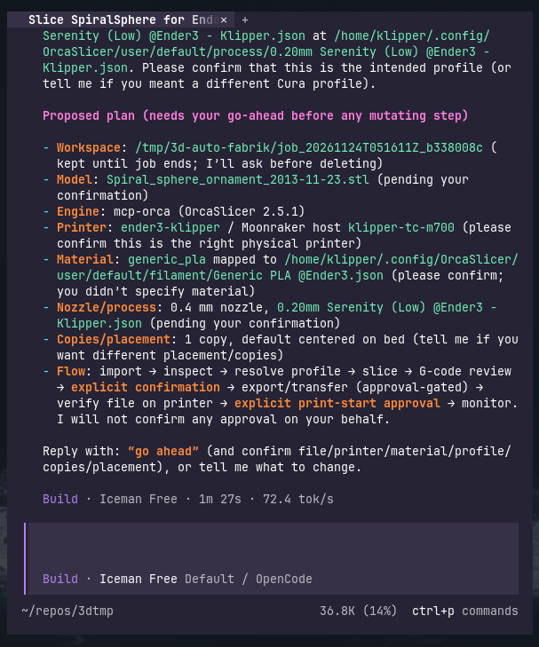
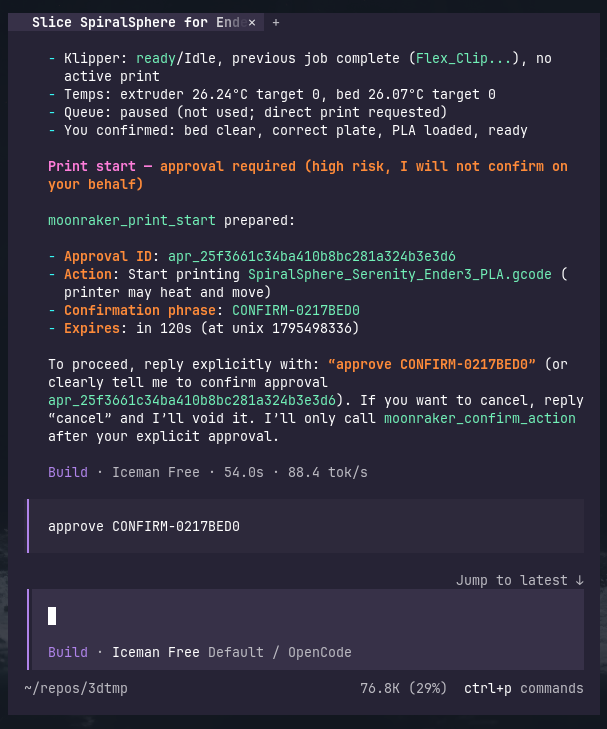

> The follow scenario are under Linux environment, and using [OpenCode] as main AI harness.

When you have an army of AI agents working on it, some tasks start hiding some complexity and the only traceability remains in agent feedback.
Currently I'm working on some PoCs to make some contexts or scenarios more reliable. I'm really think the complexity lives in abstraction of things, under this mindset, MCPs and AI Agent Skills are an powerful combo.

## Overview

The main `/goal` it's create a fully autonomous `end-to-end` 3d printing workflow.

The main idea behind [agent-skill-3d-auto-fabrik] is keep its behavior as an orchestrator with two main MCPs as executors:
[mcp-orca] or [mcp-cura], and [mcp-moonraker] as bridge.

## Motivation

Sometimes, when you want to print some stuff, only wants to copy or put a `.zip` or `.stl` file somewhere and forget about it.
That can be achieved by triggering a workflow with a watchdog monitoring a folder, or by executing some script (python or bash).

> At this time, handling webpages and downloading files directly from 3D printing hubs like
> Thingiverse, Printables, and so on are out of scope.



## Prerequisites

The skill and MCPs required a mandatory environment consisting of [klipper] and [moonraker], previously configured on the host machine.

> If you don't have a 3d printer with [klipper], I strongly recommended using [kiauh]: a simple and powerful script to manage and install
> any tools required by [klipper] environment. Check your 3D printer's compatibility.

## Wiring MCP's

> Note: you can use [mcp-cura] instead [mcp-orca] without any problems.

Now, in this guide, I'm setting up: [mcp-cura] and [mcp-moonraker] as the default environment.

> To avoid some problems, I recommended having profiles previously configured in the GUI versions of OrcaSlicer or CuraSlicer.

The [agent-skill-3d-auto-fabrik] offers a way to look for the required config files,
as well as `doctor` tools integrated into the MCPs. Any trouble or issue detected must be traceable, with tips or walkthroughs for solutions provided.

## Configuration

First of all, follow the installation instructions for [agent-skill-3d-auto-fabrik] in each repository.

### mcp-orca

Install [mcp-orca] by follwoing the instruction in the repo.

Copy the example config file provided in the [mcp-orca] repo to a custom path on your local machine:

```bash
# for linux environment
cp  /repos/mcp-orca/mcp-orca.toml ~/.config/3d-fabrik/mcp-orca.toml
```

Now, adjust the config file to match your current environment. I strongly recommend setting `binary = "orcaliscer"` to the binary's absolute path.

```toml
...
[engine]
runner = "binary"
preset = "orca"
binary = "/home/klipper/.bin/orcaslicer"
...
```

And in the agent's MCP configuration, specific the previously configured path:

```json
{
  "mcp": {
    "orca": {
      "type": "local",
      "command": ["mcp-orca", "--config", "/home/user/.config/3d-fabrik/mcp-orca.toml"]
    }
  }
}
```

Then, run the following prompt:

```text
Run mcp-orca doctor
```

The agent's response should look like this:



### mcp-moonraker

Install [mcp-moonraker] by following the instructions in the repo.

Use the following prompt:

```text
Run mcp-moonraker doctor
```

The agent's response should look like this:



## Triggering the workflow

Skill usage (main `prompt`):

```text
@3d-auto-fabrik Unzip the file located at: ~/Downloads/SpiralSphere.zip, slice it, and print it using ender3-klipper, with the PLA Generic and Serenity profiles.
```

The agent's response should look like this:



Now, at the latest step, you must be confirm the printing job:



At this point, the printing job is starting, and everything works fine!

Happy printing! >.<

> <center><i>“The most exciting phrase to hear in science, the one that heralds the most discoveries,
> is not "Eureka!", but That's funny...”</i> <br/>
> ~ <i>Isaac Asimov</i></center>

[OpenCode]: https://opencode.ai/
[agent-skill-3d-auto-fabrik]: https://github.com/martinsgmx/agent-skill-3d-auto-fabrik
[mcp-orca]: https://github.com/martinsgmx/mcp-orca
[mcp-cura]: https://github.com/martinsgmx/mcp-cura
[mcp-moonraker]: https://github.com/martinsgmx/mcp-moonraker
[moonraker]: https://moonraker.readthedocs.io/en/latest/
[kiauh]: https://github.com/dw-0/kiauh
[klipper]: https://www.klipper3d.org/
